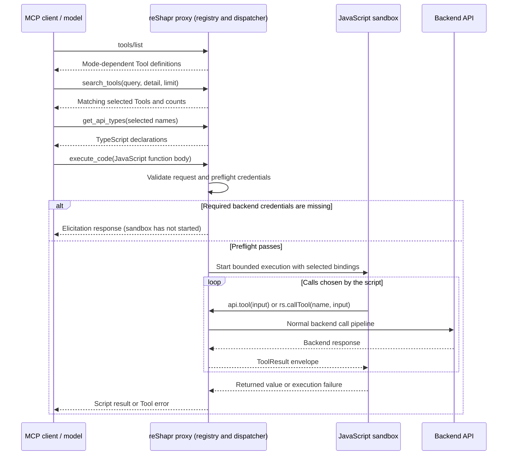

# Code Mode: Flows and Security Boundaries

Code Mode changes how an MCP client works with an Exposition, not which backend permissions it has. The model discovers a small part of the API, writes JavaScript to compose calls, and receives the script's reduced result. Execution takes place inside the reShapr proxy, rather than in the MCP client or an LLM provider's container.

For configuration and example MCP calls, see [Use Code Mode](../how-to-guides/use-code-mode.md). This page explains the behavior and tradeoffs in reShapr **1.1.0**; it does not reproduce a captured live session.

## Why Put Orchestration in the Proxy?

Direct Tool calling has two context costs: advertising operation definitions before work starts, and passing intermediate results through the model between calls. Code Mode addresses them separately:

- **Progressive discovery** loads only the definitions needed for the task.
- **Proxy-side composition** keeps intermediate payloads inside the execution path, so code can join, filter, or aggregate them before returning a result.

A single `execute_code` call can perform several backend calls without a model turn between each one. It does not eliminate those backend requests, their latency, or their memory cost. Returning a whole backend response also gives up much of the context benefit.

For a small API and a single short call, the three meta-tool descriptions and generated script may cost more than direct calling. There is no universal operation-count break-even or guaranteed token saving. `HYBRID` supports clients that need either interface, not just migrations.

## Discovery and Execution Flows

The Configuration Plan determines the advertised interface:

| Mode | `tools/list` | Direct native `tools/call` |
|---|---|---|
| `TOOLS` | Selected native Tools. | Allowed. |
| `CODE` | The three meta-tools only. | Refused; use a script. |
| `HYBRID` | Native Tools and the three meta-tools. | Allowed. |

The names `search_tools`, `get_api_types`, and `execute_code` are reserved when Code Mode is enabled. A same-named native Tool is shadowed at client dispatch, but remains callable by name from a script if it is selected by the Plan.

### Discovery Does Not Call the Backend

`search_tools` searches names and descriptions in the selected surface held by the proxy. It is lexical matching, not semantic search. Results report `returned`, `matched`, and `exposed`, so a client can detect truncation and refine its query. An empty query matches the whole surface, still subject to the result limit.

`get_api_types` generates declarations from the same input schemas used for native Tools. It describes the `api` bindings and `ToolResult` envelope; it does not execute TypeScript. Omitting the Tool selection returns the whole surface and may undo progressive discovery's context savings.

Both discovery Tools are answered before backend-credential elicitation and require no backend call. This does **not** bypass authentication on the MCP endpoint itself.

### Execution Reuses the Tool Pipeline

The snippet is a JavaScript **function body**. The proxy supplies bindings for the selected Tools, runs the body, and serializes its returned value. `api.<tool>(input)` is synchronous; `rs.callTool(name, input)` is its dynamic-name equivalent. Independent calls can use `rs.callToolAsync` and be collected with `rs.awaitPromises([promise1, promise2])`.

Calls return `{ok, content, error}`. A backend failure does not automatically abort the script: the author must check `ok`, handle a partial result, or call `rs.fail(message, data)`. Blindly reading `content` after a failure can cause another script error.

Derived calls go through the regular Tool executor, retaining applicable secret resolution, backend request header policy, output filtering, and tracing. Intermediate data is not returned as a separate model turn, but remains data processed by the proxy. This is context control, not automatic sensitive-data redaction: a script can return sensitive fields it is allowed to read, and diagnostic logging has its own exposure risks.

## Security Model

### The Plan Defines the Direct Callable Surface

The proxy derives the snippet's allow-list from the Plan's selected operations, not from declarations in submitted code. Only those Tools receive `api` bindings, and dynamic calls are checked against the same list. Guessing an unselected Tool name does not grant access.

This boundary applies to **direct snippet calls**. A selected Scripted Custom Tool can invoke its own declared lower-level operations, including cross-Service dependencies. Selection is not a substitute for backend authorization or a guarantee that every underlying operation appears in the native Tool list. See [Security Capabilities and Limits](./security-model.md).

Code Mode dispatch applies only to client-originated calls. Derived calls do not recursively redispatch into Code Mode; nested Scripted Custom Tools remain subject to script depth limits.

### The Sandbox Restricts Host Access

Code Mode shares the Scripted Custom Tools sandbox: QuickJS compiled to WebAssembly, executed through QuickJS4J and Endive. It does not provide arbitrary network access, filesystem access, `require`, `import`, or general Java host interop. The `rs` facade is the supplied route to backend operations, which use configured credentials rather than credentials embedded in the snippet.

These restrictions do not make backend writes harmless or output filters a security enforcement layer. In particular, [output filtering can fail open](../references/spec-outtools-filtering.md). Backend permissions and deployment-level controls remain necessary.

### Credentials Are Checked Before Execution

The proxy cannot assume which Tools a snippet will call: names and control flow can be computed at runtime. Instead of parsing the code, credential preflight considers selected Tools and their first level of declared dependencies, including cross-Service dependencies. It does not recursively traverse arbitrary nested declarations.

The Exposition's own backend secret is checked first. Preflight then aggregates missing elicited credentials for reachable dependencies, deduplicated by target Service and secret name, before the sandbox starts. Consequently, credentials can be requested for a Tool the script would never have called. Discovery remains available while this connection step is incomplete.

After completing elicitation, the client resubmits the snippet. Since preflight did not start execution, that initial attempt performed no script side effects. This protection is **not** a general retry or exactly-once guarantee after execution has begun.

## Guardrails and Their Boundaries

These are the defaults injected by reShapr **1.1.0**, not a recommended production sizing profile:

| Guardrail | Default | What It Bounds |
|---|---|---|
| Execution timeout | 10,000 ms | Wall-clock execution budget, including time waiting for Tool calls. |
| Tool-call budget | 10 | Calls issued through a Code Mode execution's Tool bridge; not a global request-rate limit. |
| Submitted code size | 4,000 characters | Submitted function body, not total proxy memory. |
| Serialized result size | 100,000 characters | Returned serialized script result, not bytes or backend response size. |
| Script nesting depth | 5 | Shared nesting guard for script execution. |
| WebAssembly linear memory | 256 pages of 64 KiB (16 MiB) | Per-sandbox linear-memory ceiling, configured jointly with Scripted Custom Tools. |

The [runtime reference](../references/environment-variables.md#code-mode-and-script-guardrails) owns exact configuration names and units. Backend HTTP response-size limits are separate from the script result limit: reducing a large response after fetching it does not remove the cost or limits of receiving it.

The timeout cancels the execution task with interruption. The release includes a regression test that verifies a CPU-only infinite loop stops on timeout; it is not merely a timeout on reporting the result. This is not instruction-fuel accounting and does not undo an external request already sent to a backend.

The WebAssembly ceiling does not bound total JVM memory, host-side payloads, or the combined memory of concurrent executions. Likewise, the per-execution Tool budget is not a global concurrency limit or a complete count of underlying work performed by nested Custom Tools. These guardrails complement, rather than replace, infrastructure capacity controls.

## Failures and Side Effects

| Failure | How It Is Surfaced | Consequence |
|---|---|---|
| Unknown name in `get_api_types`, missing/oversized code, or direct native call in `CODE` | JSON-RPC invalid-parameters error (`-32602`). | The request is rejected before script execution. |
| Dynamic call outside the snippet allow-list | Failed `ToolResult` envelope. | The script can inspect the error; the forbidden Tool is not called. |
| Compilation/runtime failure, timeout, or oversized serialized result | Tool result with `isError: true`, rather than a JSON-RPC transport failure. | The client receives a diagnostic; prior completed backend calls are not rolled back. |

Execution is **not transactional**. If a script writes two records and then fails, the first writes may already have succeeded. Retrying the entire snippet can duplicate work. Read-only operations, backend idempotency mechanisms, and explicit partial-failure handling determine whether a retry is safe; a sandbox cannot provide rollback for arbitrary backend APIs.

## Audit and Trace Visibility

With Plan auditing enabled, the execution audit event includes the submitted code (`mcp.code`), its digest (`mcp.code.hash`), and trace context. The proxy also logs submitted source at **INFO**, including without an OpenTelemetry collector. Never embed credentials or personal data in code, and treat both audit and application logs as sensitive.

Derived calls are traced under the execution rather than duplicated as individual audit events. The audit record describes the requested orchestration; child spans describe its calls when tracing is configured. With auditing disabled, execution identity is not logged at INFO, though DEBUG diagnostics remain. See [Logging](../references/logging.md) and [Observe the reShapr Proxy](../how-to-guides/operations/observe-and-audit.md).

## Sources and Related Patterns

Release-tagged implementation and tests establish the reShapr behavior described here:

- [Dispatch, preflight, and injected defaults](https://github.com/reshaprio/reshapr/blob/1.1.0/proxy/src/main/java/io/reshapr/proxy/mcp/ToolCallExecutor.java).
- [Selected surface, discovery, execution, and error handling](https://github.com/reshaprio/reshapr/blob/1.1.0/proxy/src/main/java/io/reshapr/proxy/mcp/code/CodeModeExecutor.java).
- [Sandbox execution, memory ceiling, and cancellation](https://github.com/reshaprio/reshapr/blob/1.1.0/proxy/src/main/java/io/reshapr/proxy/mcp/script/CustomToolScriptRunner.java), including the [CPU-loop timeout regression test](https://github.com/reshaprio/reshapr/blob/1.1.0/proxy/src/test/java/io/reshapr/proxy/mcp/script/CustomToolScriptRunnerTest.java).

[Cloudflare's Code Mode article](https://blog.cloudflare.com/code-mode/) and [Anthropic's code execution with MCP article](https://www.anthropic.com/engineering/code-execution-with-mcp) explain the wider pattern: callable code APIs, progressive discovery, and processing results outside model context. [Anthropic's programmatic tool calling](https://platform.claude.com/docs/en/agents-and-tools/tool-use/programmatic-tool-calling) is a related provider-managed implementation. Their execution environments, filesystem examples, and benchmark figures are not reShapr contracts or prerequisites.